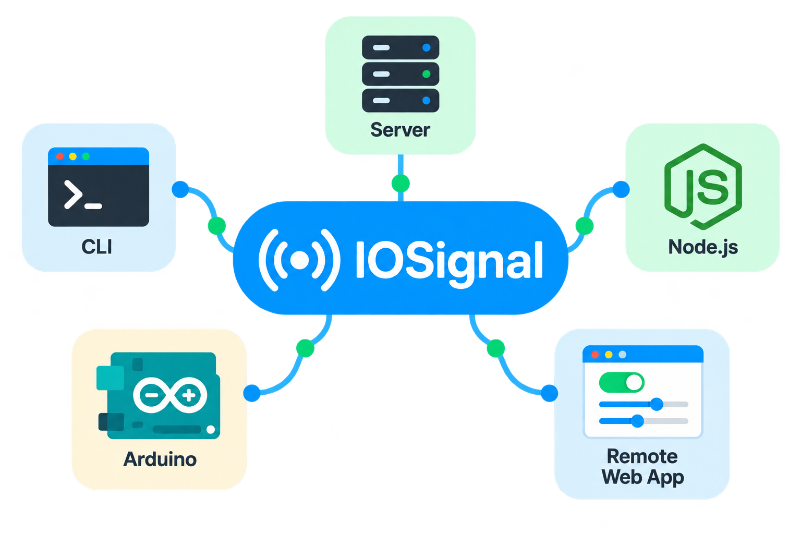

# Remocon

[한국어](README.md) | **English**

**The Remocon Arduino examples moved to [IOSignal Arduino](https://github.com/remocons/iosignal-arduino) 9.23.0.** The 22 examples and the helper headers (`IOSignalUi.h`, `IOSignalBinding.h`, `IOSignalButtons.h`, formerly `RemoconUi.h`, `RemoconBinding.h`, `RemoconButtons.h`) are under **File > Examples > IOSignal**; example guides, firmware install and board settings are on [arduino.iosignal.net](https://arduino.iosignal.net/) (Korean).

This repository holds no examples now. It is kept for future Remocon-only features. The last version with the examples is [9.22.0](https://github.com/remocons/remocon-arduino/tree/v9.22.0).

  

## Changes by version

### Next version (unreleased)

- **The examples and helper headers moved to IOSignal Arduino 9.23.0.** This library has no examples. An old sketch compiles with IOSignal alone after changing `#include <RemoconUi.h>` to `#include <IOSignalUi.h>` (the same for `RemoconBinding.h` and `RemoconButtons.h`, class `RemoconButtons` → `IOSignalButtons`).

### 9.22.0

- **New example `esp32cam-session`:** an ESP32-CAM whose pictures only one remocon.kr card can open (official type `camera-session.1`). The board setting `e2e_key` (required) only lets the card and the board prove each other; pictures are encrypted with a session key they agree over X25519. The session's secrets stay in memory, so an E2E key leaked later does not open recorded pictures. A reboot, a new connection, a new key or 10 minutes end the session and the card makes a new one. Another browser can take the session with the card's '이 브라우저로 받기' (receive in this browser) button. The key exchange is in `E2ESession.h` in the example folder.
- No changes in the library sources (`src/`) or the other examples. IOSignal Arduino stays at 9.21.0.
- The version number matches the public iosignal 9.22.0 package.

### 9.21.0

- **Requires IOSignal Arduino 9.21.0.** The dependency is now `IOSignal (>=9.21.0)`. 9.21.0 drops a connection the server stopped answering on and opens it again, keeps `loop()` running while it waits to reconnect, and uses Boho 1.1.0 with its new login nonce. See [IOSignal Arduino 9.21.0](https://github.com/remocons/iosignal-arduino/releases/tag/v9.21.0).
- **`uno-ethernet-ir`: a device key now fits the UNO.** The sketch is smaller, so it still fits with `io.auth("id.key")` uncommented (31,996 bytes without a key, about 32,210 with one, of 32,256). Before, a key pushed it past the flash size. The remote codes, the signals they send and the `on`/`off`/`toggle` commands are the same; the serial output for a received signal is one line such as `@ toggle`.
- Because `loop()` keeps running while reconnecting, the examples' buttons and board settings work while the connection is down.
- The version number matches the public iosignal 9.21.0 package. There is no Remocon numbered 9.15 to 9.20.

### 9.14.8

- **`uno-ethernet-ir`: the remote's next and previous buttons move by chapter.** Buttons 0x06 and 0x07 send `right`/`left` on `#screen` instead of `next`/`prev`. bayo.tv moves to the next or previous chapter in a video with chapters, else (no chapters, or the last one) to the next or previous video. To always move whole videos, change them back to `next`/`prev` in the sketch.
- No library code changes.

### 9.14.7

- **The `Remocon8266` example is split into three.** The old `Remocon8266` folder is gone.
  - `Remocon8266-basic`: the web app (remocon.kr) controls three outputs (built-in LED, OUT1, OUT2) as a 3-way switch, and the OLED shows the state and where each change came from (the app, SW1-SW3). SW4 shows the CID, IP and server; text sent to `<cid>@msg` (Korean too) stays on the OLED for 6 seconds.
  - `Remocon8266-tv`: four buttons control a bayo.tv screen by its CID (defaults `playToggle`, `left`, `down`, `right`), and the OLED shows the screen's play state, volume, mute, shuffle and title. In a video with chapters it shows the chapter playing, its title and number. The screen (`target`) and the button commands (`b1`-`b4`) are board settings; with no `target` the board finds the bayo.tv on the same router, and again after the screen reloads.
  - `Remocon8266-scanner`: sends `#search` like the app, lists the devices on the same router (up to 16) on the OLED, and shows the CID, name, category, type and state of the one picked with the buttons.
- Korean text uses U8g2's `u8g2_font_unifont_t_korean2` (the 2,350 KS X 1001 Hangul syllables, 16 px). Characters it does not have (emoji, decorative letters, rare syllables) are not drawn.
- All three were checked on a Remocon8266 board. No library code changes.

### 9.14.6

- **`esp01-relay-button`: the settings page reaches a running board.** RX (GPIO3) is read in normal mode too; a request from the board settings page turns GPIO1 from the LED back into serial (TX) and the board stays in setup mode until the next reset. A board that already keeps Wi-Fi no longer needs the button held at power on.
- No library code changes.

### 9.14.5

- **New example `esp01-button-controller`:** one button on the ESP-01's GPIO3 (RX) controls another device (a 4-channel relay board, an ESP-01 relay, an iris, a Remocon8266 board, a group channel), and the built-in LED (GPIO1) shows the target's state. The target CID and the button action (b1) are board settings. As RX and TX are the button and the LED, serial is on only in setup mode: when there is no Wi-Fi yet, or the button is held for the first 3 seconds after power on.
- The READMEs of `button-controller` and `iris-button-controller` showed their partner device as `undefined`; they now name `esp8266-relay4ch`.

### 9.14.4

- **Example folders were renamed.** Behaviour is unchanged. The names in the Arduino IDE examples menu change with them.
  - `Remocon8266-4ch-control` → `Remocon8266-button-controller` (it also controls devices other than relays)
  - `iris-button-control` → `iris-button-controller`
  - `iris-basic-control` → `iris-basic-controller`
  - `esp8266_relay4ch` → `esp8266-relay4ch`
  - `esp8266-d1-mini` → `d1-mini-led-button`
- The notes for earlier versions below keep the names used at the time.

### 9.14.3

- **The board setting `category` is now `name` and sets the device name too.** Its value is the `$name` itself, `name:category` (for example `Living Room Light:1F`). `:1F` keeps the sketch's name; without `:` there is no category. Empty uses the sketch default (for example `Iris Basic:HOME`). The board settings page shows it as `Name & category (name:category)`.
- A value stored under `category` is not read; set `name` again after updating if needed.
- New `remocon::formatNameSetting()` (`RemoconUi.h`) builds `$name` from the setting.
- **New examples `button-controller` and `iris-button-control`:** general controllers whose buttons control another device (a 4-channel relay board, a light, a group channel). The target CID and what each button does (b1, b2) are board settings. `button-controller` runs on a D1 mini, ESP32, ESP32-C3 or ESP32-S3 with two buttons; `iris-button-control` runs on the iris board and shows the target's channels on its four LEDs.
- `wifi-simple`: board settings `out` (an LED or relay pin following s1), `out_high` and `button` (a pin that toggles s1) make it an ESP-01 relay or button board too; it now builds for the ESP-01.

### 9.14.2

- **The board setting `group` is now `category`.** It is the app tab (remocon.kr and others) the device is listed under; the device sends `$name` as `name:category` (for example `Iris Basic:HOME`). It was renamed so it is not mistaken for a group channel; the board settings page shows it as `App tab (category)`.
- A value stored under `group` is not read. After the update the default applies (`HOME`; `iris G<group number>` for the iris group and RGB examples), so set `category` again on the [board settings page](https://test.iosignal.net/wifi/) if needed.
- The board settings table on the [test.iosignal.net](https://test.iosignal.net/) example pages explains each setting in Korean: what it does, the default and what empty means.

### 9.14.1

- **`Remocon8266-4ch-control` reads the target relay's state again.** When its buttons moved to `RemoconButtons.h` after 9.13.0, the line that passed the received `$state` on was lost: the controller stayed at `relays=----`, `link=0`, and toggles from its buttons or card sent nothing. Reinstall boards that run this example.

### 9.14.0

- **Requires IOSignal Arduino 9.14.0.** The dependency is now `IOSignal (>=9.14.0)`. 9.14.0 keeps its log texts in flash and saves RAM on the UNO (AVR): `uno-ethernet-ir` now has 822 bytes of RAM free instead of 394 and no longer stops during boot.
- **Device rules v2: devices announce themselves with `$name` and `$ui`.** `$name` is `name:category` (for example `Iris Basic:HOME`; the part after the first `:` is the app's category tab, none means uncategorized). `$ui` is a button list (`on,off,toggle`) or an official type such as `t=switch4.1`. A device with a screen of its own sends `p=1;b=…`. remocon.kr, the Android app and IOSignal Desktop no longer read the device info format of the 9.6.0 to 9.12.0 examples, so reinstall boards running those examples.
- **New header `RemoconUi.h`:** `formatName()` builds `$name` (cleaning `:` and `;` out of the name) and `nameIs()` compares another device's `$name`. `RemoconBinding.h` and `RemoconButtons.h` for the button controllers are included too.
- The board setting `group` keeps its name and is now the category in `$name`. Values already stored still apply.
- `iris-basic-control` finds its target by the name in `$name` (`Iris Basic`).

### 9.13.0

- **Requires IOSignal Arduino 9.13.0.** The dependency is now `IOSignal (>=9.13.0)`.
- **The ESP examples use board settings.** Over USB, the [board settings page](https://test.iosignal.net/wifi/) (desktop Chrome or Edge) sets Wi-Fi, the server (host:port), the device key and each example's settings, and the board keeps them. No sketch edits are needed, and the boards no longer block waiting for Wi-Fi. The example pages on [test.iosignal.net](https://test.iosignal.net/) can also install the firmware directly.
- **The app group (`g=`) is the board setting `group`.** It defaults to `HOME` and is announced again at once when changed. The iris examples use `iris G<group number>` when it is empty. The UNO examples send `g=HOME`.
- **New example `esp32cam`:** an ESP32-CAM whose pictures show on its remocon.kr device card (official type `camera.1`). With the board setting `e2e_key` the pictures are encrypted end to end, and the card needs the same key. The interval and sending on or off are set from the card.
- `Remocon8266-4ch-control`: the target CID is the board setting `target`. The remote `target=` command still works. A target stored in flash by an earlier version is moved over once.
- `esp32-group-led`: the state key to follow is the board setting `index` (0: `s1`, 1: `s2`).
- The ESP-01 examples drive the LED on GPIO 1 (TX), so they turn on serial and accept board settings only when no Wi-Fi is stored or the button is held within 3 s after power on.

### 9.12.0

- **The version number now matches the public iosignal 9.12.0 package.** The dependency is now `IOSignal (>=9.12.0)`.
- Type names became `<name>.<major>` (`light.1`, `switch4.1` and so on). The device info format changed again in 9.14.0 to the current rules (`$name`, `$ui`).
- `Remocon8266-4ch-control`: the card screen is sent in `$panel`. The bottom OLED line shows this board's CID. The default target `DEFAULT_TARGET` is the placeholder `the-cid`; set it to your relay board's CID. A target set remotely and kept in flash is used first.
- `esp8266_relay4ch`: the category is now `relays`.
- `esp32c3/esp32c3-simple` was merged into `wifi-simple`. Uncomment `LED_PIN` to drive an LED with `s1`.
- Parts, wiring, steps and a browser control panel for each example are on [test.iosignal.net](https://test.iosignal.net/) (Korean).

### 9.6.0

- **The version number now matches the public iosignal 9.6.0 package.** The dependency is now `IOSignal (>=9.6.0)`, which adds `unsubscribe()` and reconnects when a send does not go out.
- New examples: `iris-basic`, `iris-basic-control`, `iris-rgb`, `esp8266_relay4ch`, `Remocon8266-4ch-control`.
- `iris-group`, `uno-ethernet-button` and `uno-ethernet-ir` follow the device discovery and control rules of that time (`key=value` state, `#search`/`#notify`). The remote key codes in `uno-ethernet-ir` changed.
- `Remocon8266`, `esp01-relay-button`, `esp8266-d1-mini`, `uno-r4-wifi-heart`, `esp32-cid-led`, `esp32-group-led`, `wifi-simple` and `esp32c3/esp32c3-simple` now follow the same rules too. `#scan/ch` and `#$switch` are no longer used; the shared-switch channel is `#switch`. These eight were compiled and checked against the rules, not tested on boards.
- The `esp32c3-button-led` and `esp32s3-ws2812` examples were removed.
- Each example has a `README.md`.

### 9.0.0

- **The version number now matches the public iosignal package.** This release follows 4.0.0.
- The dependency is now `IOSignal (>=9.0.0)`. IOSignal Arduino 9.0.0 tells the server its receive buffer size and skips messages larger than the buffer instead of disconnecting.
- The example code is unchanged. Every example already calls `setRxBuffer()` before `begin()`.

### 4.0.0

- The dependency became `IOSignal (>=7.0.0)`. When the connection is replaced by a login with the same ID elsewhere, the device stops instead of reconnecting anonymously.

### 3.0.0

- Added board tutorials and control examples (`esp32c3-button-led`, `iris-group`, `esp32-cid-led`, `esp32-group-led` and others).

## License and references

[MIT License](LICENSE)

- [IOSignal Arduino library](https://github.com/remocons/iosignal-arduino)
- [IOSignal Arduino example site arduino.iosignal.net](https://arduino.iosignal.net/)
- [Remocon web app](https://remocon.kr)
