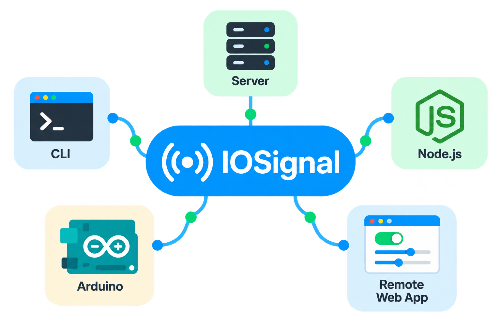

# Remocon

**한국어** | [English](README.en.md)

**Remocon 아두이노 예제는 [IOSignal Arduino](https://github.com/remocons/iosignal-arduino) 9.23.0으로 옮겼습니다.** 예제 22개와 도우미 헤더(`IOSignalUi.h`, `IOSignalBinding.h`, `IOSignalButtons.h`, 예전 `RemoconUi.h`·`RemoconBinding.h`·`RemoconButtons.h`)는 **File > Examples > IOSignal**에 있고, 예제 안내·펌웨어 설치·보드 설정은 [arduino.iosignal.net](https://arduino.iosignal.net/)에 있습니다.

이 저장소에는 지금 예제가 없습니다. 나중에 Remocon 전용 기능을 더할 자리로 남겨 둡니다. 예제가 든 마지막 버전은 [9.22.0](https://github.com/remocons/remocon-arduino/tree/v9.22.0)입니다.

  

## 버전별 변경 사항

### 다음 버전 (배포 전)

- **예제와 도우미 헤더를 IOSignal Arduino 9.23.0으로 옮겼습니다.** 이 라이브러리에는 예제가 없습니다. 예전 스케치는 `#include <RemoconUi.h>`를 `#include <IOSignalUi.h>`로(`RemoconBinding.h`, `RemoconButtons.h`도 같은 방식, 클래스 `RemoconButtons` → `IOSignalButtons`) 바꾸면 IOSignal만으로 컴파일됩니다.

### 9.22.0

- **새 예제 `esp32cam-session`:** ESP32-CAM 사진을 remocon.kr 카드 하나만 열 수 있게 보냅니다(공식 타입 `camera-session.1`). 보드 설정 `e2e_key`(필수)는 카드와 장치가 서로 확인하는 데만 쓰고, 사진은 X25519로 카드와 새로 정한 세션 키로 암호화합니다. 세션의 비밀값은 메모리에만 있어, 나중에 E2E 키가 새어도 녹화해 둔 지난 사진은 풀리지 않습니다. 세션은 재부팅, 다시 접속, 키 변경, 10분 경과로 끝나고 카드가 새로 맺습니다. 다른 브라우저는 '이 브라우저로 받기'로 세션을 가져올 수 있습니다. 키 교환은 예제 폴더의 `E2ESession.h`에 있습니다.
- 라이브러리 소스(`src/`)와 기존 예제는 바뀌지 않았습니다. IOSignal Arduino는 9.21.0 그대로 씁니다.
- 버전 번호를 공개 iosignal 9.22.0과 맞췄습니다.

### 9.21.0

- **IOSignal Arduino 9.21.0이 필요합니다.** 의존성을 `IOSignal (>=9.21.0)`으로 올렸습니다. 9.21.0은 응답 없는 연결을 스스로 끊고 다시 연결하고, 다시 연결을 기다리는 동안 `loop()`를 멈추지 않으며, 로그인 nonce를 바꾼 Boho 1.1.0을 씁니다. 자세한 내용은 [IOSignal Arduino 9.21.0](https://github.com/remocons/iosignal-arduino/releases/tag/v9.21.0)에 있습니다.
- **`uno-ethernet-ir`: 장치 키를 넣어도 UNO에 들어갑니다.** 스케치를 줄여 `io.auth("id.key")`의 주석을 풀어도 플래시에 들어갑니다(키 없이 31,996바이트, 키 사용 약 32,210바이트, 최대 32,256). 전에는 키를 넣으면 플래시를 넘었습니다. 리모컨 코드와 보내는 신호, `on`/`off`/`toggle` 명령은 그대로이고, 받은 신호의 시리얼 출력은 `@ toggle`처럼 한 줄로 줄었습니다.
- 재연결 중에 `loop()`가 멈추지 않으므로, 연결이 끊긴 동안에도 예제의 버튼과 보드 설정이 동작합니다.
- 버전 번호를 공개 iosignal 9.21.0과 맞췄습니다. 9.15~9.20 번호의 Remocon은 없습니다.

### 9.14.8

- **`uno-ethernet-ir`: 리모컨의 다음·이전 버튼이 챕터를 옮깁니다.** 0x06·0x07 버튼이 `#screen`으로 `next`/`prev` 대신 `right`/`left`를 보냅니다. bayo.tv는 챕터가 있는 영상이면 다음·이전 챕터로, 없거나 마지막 챕터면 다음·이전 영상으로 옮깁니다. 항상 영상 단위로 옮기려면 스케치에서 `next`/`prev`로 바꿉니다.
- 라이브러리 코드는 바뀌지 않았습니다.

### 9.14.7

- **`Remocon8266` 예제를 세 개로 나눴습니다.** 기존 `Remocon8266` 폴더는 없어졌습니다.
  - `Remocon8266-basic`: 웹앱(remocon.kr)에서 출력 3개(내장 LED, OUT1, OUT2)를 3구 스위치로 제어하고, 바뀐 상태와 출처(앱, SW1~SW3)를 OLED에 보여 줍니다. SW4는 CID·IP·서버, `<cid>@msg`의 글(한글 가능)은 OLED에 6초 동안 나옵니다.
  - `Remocon8266-tv`: 버튼 4개로 bayo.tv 화면을 CID로 제어하고(기본 `playToggle`, `left`, `down`, `right`), 화면의 재생 상태·음량·음소거·셔플과 제목을 OLED에 보여 줍니다. 챕터가 있는 영상은 지금 챕터의 제목과 번호를 보여 줍니다. 대상 화면(`target`)과 버튼 명령(`b1`~`b4`)은 보드 설정이고, `target`이 비면 같은 공유기의 bayo.tv를 찾고 화면이 새로 고쳐지면 다시 찾습니다.
  - `Remocon8266-scanner`: 앱처럼 `#search`를 보내 같은 공유기의 장치(최대 16대)를 OLED에 목록으로 보여 주고, 버튼으로 골라 CID·이름·분류·타입·상태를 봅니다.
- 한글은 U8g2의 `u8g2_font_unifont_t_korean2`(KS X 1001 한글 2,350자, 16px)로 그립니다. 폰트에 없는 글자(이모지, 꾸밈 문자, 드문 음절)는 그리지 않습니다.
- 세 예제 모두 Remocon8266 보드에서 확인했습니다. 라이브러리 코드는 바뀌지 않았습니다.

### 9.14.6

- **`esp01-relay-button`: 동작 중에도 설정 페이지에서 설정할 수 있습니다.** 일반 모드에서도 RX(GPIO3)를 읽어, 보드 설정 페이지가 요청을 보내면 GPIO1을 LED 대신 시리얼(TX)로 바꾸고 다음 리셋까지 설정 모드가 됩니다. 이미 Wi-Fi가 저장된 보드도 버튼을 누른 채 전원을 넣지 않아도 됩니다.
- 라이브러리 코드는 바뀌지 않았습니다.

### 9.14.5

- **새 예제 `esp01-button-controller`:** ESP-01의 GPIO3(RX) 버튼 하나로 다른 장치(4채널 릴레이, ESP-01 릴레이, iris, Remocon8266, 그룹 채널)를 제어하고, 내장 LED(GPIO1)로 대상의 상태를 보여 줍니다. 대상 CID와 버튼 동작(b1)은 보드 설정입니다. RX·TX를 버튼과 LED로 쓰므로, Wi-Fi가 없거나 켠 뒤 3초 안에 버튼을 누르고 있을 때만 시리얼이 켜지는 설정 모드로 시작합니다.
- `button-controller`, `iris-button-controller` 예제 README의 연동 장치가 `undefined`로 보이던 것을 고쳤습니다(`esp8266-relay4ch`).

### 9.14.4

- **예제 폴더 이름을 정리했습니다.** 동작은 그대로입니다. Arduino IDE의 예제 메뉴 이름도 함께 바뀝니다.
  - `Remocon8266-4ch-control` → `Remocon8266-button-controller` (릴레이가 아닌 장치도 제어합니다)
  - `iris-button-control` → `iris-button-controller`
  - `iris-basic-control` → `iris-basic-controller`
  - `esp8266_relay4ch` → `esp8266-relay4ch`
  - `esp8266-d1-mini` → `d1-mini-led-button`
- 아래 이전 버전 설명의 예제 이름은 그때 이름 그대로입니다.

### 9.14.3

- **보드 설정 `category`를 `name`으로 바꿔 장치 이름도 함께 정합니다.** 값은 `$name` 그대로 `이름:분류`입니다(예: `거실 조명:1층`). `:1층`처럼 이름을 비우면 스케치의 이름을 쓰고, `:`가 없으면 분류 없이 이름만 보냅니다. 비우면 스케치 기본값(예: `Iris Basic:HOME`)입니다. 보드 설정 화면에는 `Name & category (name:category)`로 나옵니다.
- 예전 `category`에 저장한 값은 읽지 않습니다. 업데이트 뒤 필요하면 `name`을 다시 넣으세요.
- 새 함수 `remocon::formatNameSetting()`(`RemoconUi.h`)이 설정값으로 `$name`을 만듭니다.
- **새 예제 `button-controller`, `iris-button-control`:** 버튼으로 다른 장치(4채널 릴레이, 전등, 그룹 채널)를 제어하는 범용 제어기입니다. 대상 CID와 버튼마다 할 일(b1, b2)을 보드 설정으로 정합니다. `button-controller`는 D1 mini·ESP32·ESP32-C3·ESP32-S3에 버튼 두 개, `iris-button-control`은 iris 보드이며 LED 4개에 대상의 채널 상태를 보여 줍니다.
- `wifi-simple`: 보드 설정 `out`(s1을 따르는 LED·릴레이 핀), `out_high`, `button`(s1을 토글하는 버튼 핀)을 더해 ESP-01 릴레이·버튼 보드로도 씁니다. ESP-01 빌드를 추가했습니다.

### 9.14.2

- **보드 설정 `group`의 이름을 `category`로 바꿨습니다.** 이 값은 앱(remocon.kr 등)에서 장치가 나오는 탭 이름이고, 장치는 `$name`을 `이름:category`로 보냅니다(예: `Iris Basic:HOME`). 그룹 채널과 헷갈리지 않도록 이름을 바꿨고, 보드 설정 화면에는 `App tab (category)`로 나옵니다.
- 예전 `group`에 저장한 값은 읽지 않습니다. 업데이트하면 기본값(`HOME`, iris 그룹·RGB는 `iris G<그룹 번호>`)으로 돌아가므로 필요하면 [보드 설정](https://test.iosignal.net/wifi/)에서 `category`를 다시 넣으세요.
- [test.iosignal.net](https://test.iosignal.net/) 예제 페이지의 보드 설정 표에 항목마다 하는 일, 기본값, 비웠을 때의 동작을 한국어로 적었습니다.

### 9.14.1

- **`Remocon8266-4ch-control`이 대상 릴레이의 상태를 다시 받습니다.** 9.13.0 이후 버튼 처리를 `RemoconButtons.h`로 옮기며 받은 `$state`를 넘기는 줄이 빠져, 제어기가 `relays=----`, `link=0`에 머물고 버튼·카드로 토글해도 아무것도 보내지 않았습니다. 이 예제를 쓰는 보드는 다시 설치하세요.

### 9.14.0

- **IOSignal Arduino 9.14.0이 필요합니다.** 의존성을 `IOSignal (>=9.14.0)`으로 올렸습니다. 9.14.0은 로그 문구를 플래시에 두어 UNO(AVR)의 RAM을 아낍니다. `uno-ethernet-ir`은 남는 RAM이 394바이트에서 822바이트로 늘어 부팅 중 멈추지 않습니다.
- **장치 규칙 v2: 장치는 `$name`과 `$ui`로 자신을 알립니다.** `$name`은 `이름:분류`(예: `Iris Basic:HOME`, 첫 `:` 뒤가 앱의 분류 탭, 없으면 미분류), `$ui`는 버튼 목록(`on,off,toggle`) 또는 공식 타입 `t=switch4.1`입니다. 자체 화면을 보내는 장치는 `p=1;b=…`처럼 씁니다. 9.6.0~9.12.0 예제의 장치 정보 형식은 remocon.kr, 안드로이드 앱, IOSignal Desktop이 더 읽지 않으므로, 그 예제를 올린 보드는 다시 설치하세요.
- **새 헤더 `RemoconUi.h`:** `formatName()`으로 `$name`을 만들고(이름 속 `:`·`;` 정리), `nameIs()`로 다른 장치의 `$name`을 비교합니다. 버튼 제어기용 `RemoconBinding.h`, `RemoconButtons.h`도 함께 들어 있습니다.
- 보드 설정 `group`은 이름이 그대로이고, 이제 `$name`의 분류로 쓰입니다. 이미 저장된 값도 그대로 씁니다.
- `iris-basic-control`: 대상을 `$name`의 이름(`Iris Basic`)으로 찾습니다.

### 9.13.0

- **IOSignal Arduino 9.13.0이 필요합니다.** 의존성을 `IOSignal (>=9.13.0)`으로 올렸습니다.
- **ESP 예제가 보드 설정을 씁니다.** USB로 연결해 [보드 설정 페이지](https://test.iosignal.net/wifi/)(데스크톱 Chrome·Edge)에서 Wi-Fi, 서버(호스트:포트), 장치 키와 예제별 설정을 넣으면 보드가 저장합니다. 스케치를 고치지 않아도 되고, Wi-Fi 연결을 기다리며 멈추지 않습니다. [test.iosignal.net](https://test.iosignal.net/) 예제 페이지에서 펌웨어를 바로 설치할 수도 있습니다.
- **앱의 그룹(`g=`)을 보드 설정 `group`으로 바꿉니다.** 기본값은 `HOME`이고, 바꾸면 바로 다시 알립니다. iris 예제는 비워 두면 `iris G<그룹 번호>`입니다. UNO 예제는 `g=HOME`을 보냅니다.
- **새 예제 `esp32cam`:** ESP32-CAM이 찍은 사진을 remocon.kr 장치 카드에 보여 줍니다(공식 타입 `camera.1`). 보드 설정 `e2e_key`를 넣으면 사진을 끝에서 끝까지 암호화하고, 카드에도 같은 키를 넣어야 보입니다. 간격(`interval`)과 전송 켜기·끄기는 카드에서 바꿉니다.
- `Remocon8266-4ch-control`: 제어 대상 CID가 보드 설정 `target`입니다. 원격 `target=` 명령도 그대로 됩니다. 예전 버전이 플래시에 저장한 대상은 한 번 옮겨 씁니다.
- `esp32-group-led`: 따를 상태 키를 보드 설정 `index`(0: `s1`, 1: `s2`)로 고릅니다.
- ESP-01 예제는 GPIO 1(TX)이 LED라, 저장된 Wi-Fi가 없거나 켠 뒤 3초 안에 버튼을 누르고 있을 때만 시리얼을 켜고 보드 설정을 받습니다.

### 9.12.0

- **버전 번호를 공개 iosignal 9.12.0과 맞췄습니다.** 의존성을 `IOSignal (>=9.12.0)`으로 올렸습니다.
- 타입 이름이 `<이름>.<major>`(`light.1`, `switch4.1` 등)로 바뀌었습니다. 장치 정보 형식은 9.14.0에서 지금 규칙(`$name`, `$ui`)으로 다시 바뀌었습니다.
- `Remocon8266-4ch-control`: 카드 화면을 `$panel`로 보냅니다. OLED 맨 아래 줄에 이 보드의 CID를 표시합니다. 기본 대상 `DEFAULT_TARGET`은 자리표시자 `the-cid`이니 릴레이 보드의 CID로 바꾸세요. 원격으로 지정해 플래시에 저장된 대상이 있으면 그 값을 먼저 씁니다.
- `esp8266_relay4ch`: 분류를 `relays`로 바꿨습니다.
- `esp32c3/esp32c3-simple`을 `wifi-simple`에 합쳤습니다. `LED_PIN` 주석을 풀면 `s1` 값으로 LED를 켭니다.
- 예제별 준비물, 배선, 순서와 브라우저 제어 화면은 [test.iosignal.net](https://test.iosignal.net/)에 있습니다.

### 9.6.0

- **버전 번호를 공개 iosignal 9.6.0과 맞췄습니다.** 의존성을 `IOSignal (>=9.6.0)`으로 올렸습니다. IOSignal Arduino 9.6.0에는 `unsubscribe()`와 전송 실패 시 재접속이 들어 있습니다.
- 새 예제: `iris-basic`, `iris-basic-control`, `iris-rgb`, `esp8266_relay4ch`, `Remocon8266-4ch-control`.
- `iris-group`, `uno-ethernet-button`, `uno-ethernet-ir`이 그때의 장치 검색·제어 규칙(`key=value` 상태, `#search`/`#notify`)을 따릅니다. `uno-ethernet-ir`의 리모컨 키 코드가 바뀌었습니다.
- `Remocon8266`, `esp01-relay-button`, `esp8266-d1-mini`, `uno-r4-wifi-heart`, `esp32-cid-led`, `esp32-group-led`, `wifi-simple`, `esp32c3/esp32c3-simple`도 같은 규칙을 따르도록 바꿨습니다. `#scan/ch`, `#$switch`는 더 쓰지 않고, 공유 스위치 채널은 `#switch`입니다. 이 8개는 컴파일과 규칙 검사만 했고 실제 보드에서는 확인하지 않았습니다.
- `esp32c3-button-led`와 `esp32s3-ws2812` 예제를 삭제했습니다.
- 예제마다 `README.md`가 있습니다.

### 9.0.0

- **버전 번호를 공개 iosignal과 맞췄습니다.** 4.0.0 다음 버전입니다.
- 의존성을 `IOSignal (>=9.0.0)`으로 올렸습니다. IOSignal Arduino 9.0.0은 수신 버퍼 크기를 서버에 알리고, 버퍼보다 큰 메시지는 연결을 끊지 않고 건너뜁니다.
- 예제 코드는 바뀌지 않았습니다. 모든 예제가 이미 `begin()` 전에 `setRxBuffer()`를 호출합니다.

### 4.0.0

- 의존성을 `IOSignal (>=7.0.0)`으로 지정했습니다. 같은 ID로 다른 곳에서 로그인해 연결이 교체되면 장치가 익명으로 다시 접속하지 않고 멈춥니다.

### 3.0.0

- 보드별 튜토리얼과 제어 예제(`esp32c3-button-led`, `iris-group`, `esp32-cid-led`, `esp32-group-led` 등)를 추가했습니다.

## 라이선스 및 참고

[MIT License](LICENSE)

- [IOSignal Arduino 라이브러리](https://github.com/remocons/iosignal-arduino)
- [IOSignal 아두이노 예제 사이트 arduino.iosignal.net](https://arduino.iosignal.net/)
- [Remocon 웹앱](https://remocon.kr)
